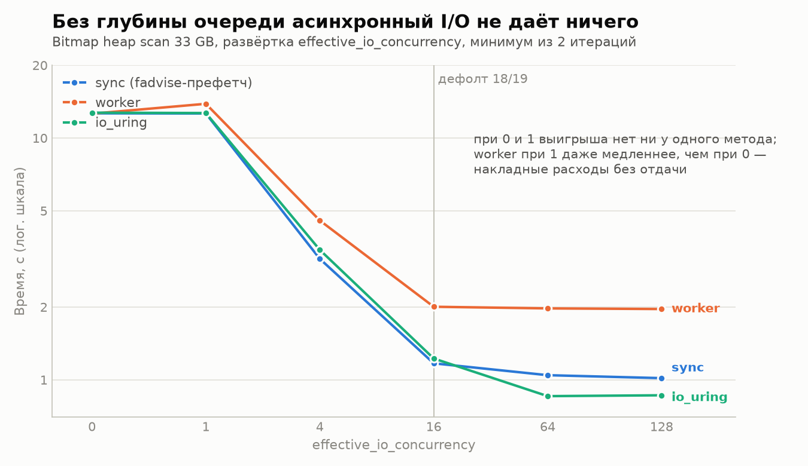
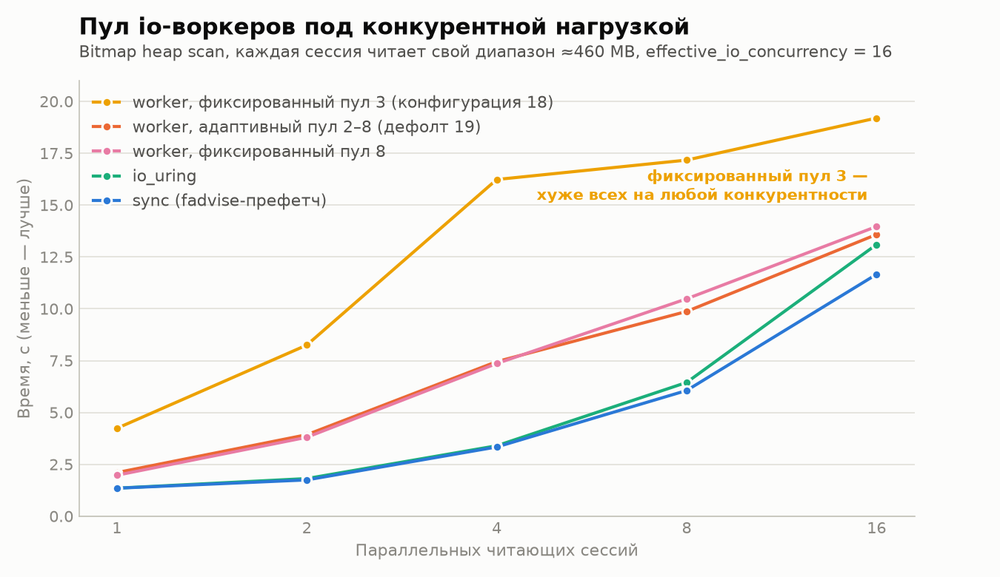

# Асинхронный I/O в PostgreSQL: где стало быстрее, где ничего не изменилось и почему

Про асинхронный ввод-вывод в PostgreSQL за последний год написали многие:

- Selectel — [«PostgreSQL 18: новый AIO ускоряет запросы до 3-х раз. Что происходит?»](https://habr.com/ru/companies/selectel/articles/951172/);
- pganalyze — [«Waiting for Postgres 18: Accelerating Disk Reads with Asynchronous I/O»](https://pganalyze.com/blog/postgres-18-async-io) с бенчмарками 17 против 18 на AWS;
- credativ — [«PostgreSQL 18 Asynchronous Disk I/O — Deep Dive Into Implementation»](https://www.credativ.de/en/blog/postgresql-en/postgresql-18-asynchronous-disk-i-o-deep-dive-into-implementation/) с разбором реализации.

Механизм появился в 18-й версии, в 19-й его докрутили и в релиз-нотах он числится среди главных улучшений производительности.

Проблема в том, что по релиз-нотам сложно понять, в чём профит для отдельно взятого DBA. Есть список коммитов: «improve asynchronous I/O read-ahead scheduling for large requests», «allow `io_method` method `worker` to automatically control needed background workers». Всё правда, но это всё общие формулировки и всё мимо, если вопрос стоит так: стало быстрее или медленнее, и в каких именно местах?

После апгрейда если стало быстрее — хорошо, а почему стало быстрее не углубляются (но углубляются, если стало хуже). И здесь ситуация неудобная: с одной стороны, понятно, что в новой версии глобально есть это асинхронное чтение, а на что это влияет конкретно? Скорость отдельных запросов? Или способ доступа к данным конкретными потребителями? А как это выглядит с точки зрения мониторинга и вообще нужно ли как-то адаптировать настройки мониторинга? Вопросы могут быть и другие, но они точно должны возникнуть в голове искушенного DBA.

Я сам столкнулся с подобными вопросами, поэтому я поставил стенд, погонял ворклоады, померил, посмотрел на результаты. Ниже — карта моего похода выходного дня: где апгрейд ускоряет и на сколько, где не меняет ничего, где настройкой можно выжать ещё вдвое и где два параметра способны выключить всю фичу целиком. Все скрипты и сырые данные я сложил в репозитории, ссылка будет в конце поста.

## Асинхронным был лишь один сценарий

До 18-й версии PostgreSQL читал с диска синхронно: бэкенд обнаруживал, что ему нужна страница, которой нет в буферном кеше, звал `pread()` и вставал. На стенде (о нём чуть ниже) одна такая операция стоит около 0.2 мс. Звучит безобидно, пока не посчитать: запросу, которому нужно достать шестьдесят тысяч разрозненных страниц, это уже обойдётся в двенадцать секунд ожидания.

Ровно одно исключение существовало с версии 8.4 (июль 2009 года). В 8.4 добавили упреждающее чтение для bitmap heap scan: прежде чем читать страницы по списку из битовой карты, PostgreSQL сообщал ядру через `posix_fadvise(WILLNEED)`, какие блоки понадобятся дальше. Глубину этой очереди задавал `effective_io_concurrency`.

Две важные детали. Первая, этот префетч работает только для bitmap heap scan. Формулировка [документации 17-й](https://www.postgresql.org/docs/17/runtime-config-resource.html) звучит так: «Currently, this setting only affects bitmap heap scans». Последовательное чтение, вакуум, чтение по индексу... все остальные мимо. Вторая, `effective_io_concurrency` по умолчанию равен единице: «The default is 1 on supported systems». То есть даже там, где механизм работал, он был настроен до минимума. Так что до 18-й версии асинхронность в PostgreSQL была не общим системным механизмом, а скорее точечным решением в одном месте, и по умолчанию почти выкрученным до минимума - это в целом было оправдано, учитывая богатое разнообразие слоев хранения (HDD, SSD, NVMe, hardware/software RAID, Flashcache/BCache, LVM, DRBD, ZFS, NFS, CEPH, GlusterFS, ...) выбрать универсальный дефолт просто невозможно и ответственность за точную настройку `effective_io_concurrency` переложили на DBA - ему виднее, какая у него инфра, пусть и крутит соответствующе.

## Что появилось в 17-й, 18-й и 19-й

Здесь легко запутаться, так как фича собиралась три релиза подряд, и разные её части приехали в разное время.

**17-я** принесла слой read stream и параметр `io_combine_limit`. Read stream это общий способ читать поток страниц вместо отдельных запросов, а `io_combine_limit` задаёт, сколько соседних блоков склеивать в одну операцию; [по умолчанию 128 kB](https://www.postgresql.org/docs/17/runtime-config-resource.html), то есть шестнадцать страниц вместо одной. Заметнее всего это сказалось на последовательном чтении. Асинхронности при этом ещё не было — операции просто стали крупнее.

**18-я** добавила саму асинхронность. Появился `io_method` — как именно выполнять чтения:

- `worker` (дефолт) — чтение выполняют отдельные процессы io worker; бэкенд отдаёт заявку и ждёт уведомления;
- `io_uring` — бэкенд сам отправляет операции в `io_uring` ядра Linux; требует сборки с `--with-liburing`;
- `sync` — чтение выполняет сам бэкенд.

Read stream распространили на bitmap heap scan и вакуум, добавили `io_max_combine_limit` и подняли дефолт `effective_io_concurrency` с 1 до 16. Аргументация смены дефолта — в [коммите](https://www.mail-archive.com/pgsql-committers@lists.postgresql.org/msg39193.html): единица стояла с 8.4 ради минимального риска регрессий, а тесты на современном железе — от облачных дисков до NVMe — показали, что даже умеренное повышение даёт заметный выигрыш.

**19-я** добавляет две вещи. Число io-воркеров теперь управляется автоматически: вместо одного `io_workers` теперь пара `io_min_workers = 2` и `io_max_workers = 8`, плюс `io_worker_idle_timeout` и `io_worker_launch_interval`. И у `EXPLAIN ANALYZE` появилась опция `IO`.

Здесь оговорюсь, чтобы не создавать ложных ожиданий: почти всё, что вы увидите ниже, приехало год назад в **18-ю**, а объединение блоков — вообще два года назад в 17-ю. Собственно 19-я добавляет автоматический пул и наблюдаемость. Мерил я на 19-beta2 по причине, что сравнивать методы надо внутри одной версии, если сравнивать между мажорами, то можно запутаться и намерять лишнего, так как вместе с вводом-выводом улучшается и планировщик, и вакуум, и блокировки, и многое другое.

И то, чего нет ни в 18-й, ни в 19-й: асинхронной записи. Checkpointer и bgwriter остались синхронными. Не путать с существующим asynchronous commit, который про отложенный fsync WAL при коммите, то есть про гарантии сохранности, а не про механику чтения. Всё, о чём идёт речь дальше, касается только чтения.

## Стенд, методика и точка отсчёта

Асинхронный ввод-вывод не делает диск быстрее (физику не перепрыгнешь), он прячет ожидание: пока одна операция летит, можно отправить следующие. И выигрыш пропорционален латентности хранилища и глубине очереди, которую до него удаётся довести. На диске с около-нулевой латентностью (например, SSD, NVMe, TMPFS/RAMFS) прятать нечего.

Поэтому **стенд намеренно медленный**. Одиночное случайное чтение — 0.206 мс, тогда как локальный NVMe даёт 0.02–0.05 мс, и на таком железе весь эффект будет заметно скромнее моих чисел.

Считаю это плюсом. На сегодня еще не все могут позволить себе локальный NVMe под базой: в облаке это обычно сетевой диск, в своей стойке — SAN или Ceph, в Kubernetes — персистентный том через CSI-драйвер, за которым та же сеть. Десятые доли миллисекунды — норма для прода, а не патология стенда. Но это моя позиция экспериментатора, а не измеренный факт: на быстром хранилище я не мерил, стенд был один.

Сам стенд: KVM/Proxmox, 8 vCPU, 4 GB RAM, диск raw с `cache=none` и `aio=native`, ext4, `read_ahead_kb = 128`; кеш гипервизора отсутствует, проверено отдельно. PostgreSQL 19beta2, важный момент: числа сняты на бете и к релизу могут поехать. Имена событий ожидания я тоже снимал со стенда, через `pg_wait_events`. Полный конфиг и параметры виртуалки — в репо, тут же важно одно: `shared_buffers = 512MB` и `max_parallel_workers_per_gather = 0`, чтобы параллелизм не дал сайд-эффектов.

Данные: таблица 33 GB плюс индекс 401 MB, 60 миллионов строк. Корреляция ключа выборки −0.0056 — нужные строки размазаны по таблице равномерно. Отношение датасета к памяти ~8.7:1.

Три нагрузки:

```sql
SELECT sum(id) FROM bench WHERE sel_key >= 5000 AND sel_key < 6000;  -- bitmap, ≈460 MB
SELECT sum(id) FROM bench;                                           -- seq scan, 33 GB
VACUUM (DISABLE_PAGE_SKIPPING) bench;                                -- вакуум, 33 GB
```

Пояснения. `sum(id)`, а не `count(*)`: колонки `id` нет в индексе, иначе планировщик ушёл бы в index-only scan с пофигом на таблицу. `DISABLE_PAGE_SKIPPING` обязателен, так как таблица заморожена и целиком all-visible, обычный вакуум забьёт и всё пропустит. И вакуум читает через свой `maintenance_io_concurrency` (не через `effective_io_concurrency`), это отдельный параметр со своим дефолтом.

Между итерациями для чистоты эксперимента остановка СУБД, `sync`, `echo 3 > drop_caches`, запуск - всё как обычно, чтобы почистить состояние кешей (shared_buffers, page cache) от предыдущего прогона и не распространить на следующий.

**Про агрегацию, чтобы числа можно было проверить.** Данные снимались тремя сериями с разной методикой, и усреднять их между собой я не стал. Головная таблица — медиана из трёх итераций. Развёртки по `effective_io_concurrency` и `io_combine_limit` — минимум из двух. Развёртка по числу сессий — самая медленная сессия в итерации, затем медиана из трёх. Поэтому одна конфигурация в разных таблицах может отличаться на несколько процентов: сравнивать нужно внутри таблицы, а не между ними.

Профиль диска по fio:

| Тест | IOPS | MiB/s | avg | p50 | p99 |
|---|---|---|---|---|---|
| randread 8k, глубина 1 | 4 845 | 38 | 0.206 мс | 0.196 мс | 0.305 мс |
| randread 8k, глубина 16 | 60 736 | 475 | 0.263 мс | 0.255 мс | 0.391 мс |
| seqread 128k, глубина 16 | 8 466 | 1 058 | 1.889 мс | 1.876 мс | 2.146 мс |

Переход от глубины 1 к глубине 16 даёт **×12.5 по числу операций**, а латентность растёт всего на 28%. Вот этот запас асинхронное чтение и должно забрать.

И самое важное — про точку отсчёта. `io_method = sync` это **не** «поведение до асинхронности». Под `sync` read stream всё равно строит очередь глубиной `effective_io_concurrency`, просто через старый `posix_fadvise`. Если посмотреть `strace` одного bitmap-скана: при effective_io_concurrency = 16 бэкенд делает ~58k вызовов `fadvise64`, при effective_io_concurrency = 0 — ни одного, только ~58k `pread64`. Настоящая точка «до» — это effective_io_concurrency = 0.

## Сколько даёт апгрейд, если ничего не трогать

Главный вопрос: что получает человек, который обновился и не собирается открывать конфиг.

За «до» я беру чтение без очереди — `sync` при effective_io_concurrency = 0. За «после» — дефолты 19-й: `io_method = worker`, effective_io_concurrency = 16. Три итерации на ячейку, медиана.

| Нагрузка | поведение 17-й | 19-я, дефолты | Разница |
|---|---|---|---|
| Bitmap heap scan (≈460 MB) | 12 708 мс | 2 011 мс | **×6.3** |
| Seq scan, 33 GB | 58 817 мс | 35 349 мс | **×1.7** |
| VACUUM, 33 GB | 58 568 мс | 35 883 мс | **×1.6** |

Про выбор базы стоит сказать отдельно, иначе цифры повисают.

За «поведение 17-й» я выдаю прогоны с `effective_io_concurrency` = 0, хотя формальный дефолт 17-й — единица. Разницы между ними почти нет, а там, где есть, то единица только хуже: очередь глубиной один несёт все накладные расходы префетча (лишний сисколл на каждый блок) без его выгоды, заказанный блок к моменту чтения всё равно не приехал. В коммите, поднявшем дефолт с 1 до 16, это также подтверждается: «1 actually performs worse than 0». На bitmap heap scan оба варианта дали одинаково (12 705 мс и 12 708 мс), на seq scan и вакууме единица накинула бы ~14% и нарисовала бы мне более красивые ×1.9 и ×1.8, но я взял честные меньшие.

Что стоит за цифрами. Таблица весит 33 482 MiB; поделив на время, получаем 569 MiB/s у 17-й против 947 MiB/s у 19-й при физическом потолке диска 1 058 MiB/s. То есть без асинхронного чтения PostgreSQL забирал у диска чуть больше половины возможного, а с ним — около девяноста процентов.

Это оказалось самое неожиданное число во всём эксперименте. Мне казалось, что на последовательном чтении разницы почти не будет: readahead ядра работает и без асинхронности, а объединение блоков появилось ещё в 17-й. Оказалось, readahead упирается в свои 128 килобайт, и очередь поглубже забирает у диска в полтора с лишним раза больше.

Больше всех выигрывает bitmap heap scan — ×6.3. Но выигрывает он не благодаря асинхронности, и об этом дальше.

## Сколько можно выжать настройкой

Противоположный вопрос: сколько ещё лежит в конфиге. Короткий ответ — зависит от нагрузки, и разброс огромный.



Слева, при effective_io_concurrency 0 и 1, победителя нет — все три держатся около 12.6 секунды, а `worker` при единице даже медленнее, чем при нуле: 13 853 мс против 12 609 мс. Накладные расходы асинхронности без единого шанса их окупить.

Дальше методы расходятся. `worker` выходит на полку сразу после дефолтных 16 и больше не улучшается. `sync` доходит до полки к 64. А `io_uring` продолжает выигрывать от глубины очереди и на 64 даёт 856 мс — против 1 974 мс у `worker` в той же точке развёртки, то есть ещё вдвое. В головной таблице предыдущего раздела та же пара конфигураций дала 848 мс и 2 011 мс. Это на bitmap heap scan.

На последовательном чтении и вакууме настройка не даёт ничего: смена метода на `io_uring` (глубину очереди для вакуума задаёт `maintenance_io_concurrency`, он остался дефолтным) выигрывает у дефолта 2.5% и 3.1% при разбросе внутри самих ячеек до 19%. Шум, а не выигрыш — уже на дефолте PostgreSQL читает 947 MiB/s из 1 058 физически возможных, более глубокая очередь не сделает диск быстрее.

Второй параметр, `io_combine_limit`, интересен тем, как он ломается. Развёртка на последовательном чтении:

| Блоков в операции | `sync` | `worker` |
|---|---|---|
| 1 (8 kB) | 61 500 мс | **62 540 мс** |
| 4 (32 kB) | 61 022 мс | 45 307 мс |
| 16 (128 kB, дефолт) | 59 132 мс | 32 314 мс |
| 32 (256 kB) | 46 266 мс | 31 800 мс |

При `io_combine_limit = 1` асинхронное чтение не даёт ничего — 62.5 секунды против 61.5 секунды у синхронного, то есть даже чуть хуже. Значение 32 требует поднять ещё и `io_max_combine_limit` и перезапустить сервер, так что бесплатным его считать не стоит.

Отсюда вывод, который можно запомнить. Асинхронный ввод-вывод в PostgreSQL стоит на двух ногах: глубина очереди и объединение блоков. Глубина — сколько запросов к диску «в полёте» одновременно, латентность каждого прячется за соседними. Объединение — размер одной порции, чем она крупнее, тем меньше накладных расходов на каждый прочитанный байт. Поодиночке получается суета на кассе супермаркета: покупателей много, у каждого по одной жвачке, и каждый платит полную цену обслуживания. Вместе — заводской конвейер: крупные партии сплошным потоком. Правда, разогнать конвейер бесконечно нельзя, потолок у него один — физическая полоса диска, и дефолт уже стоит рядом с ним. Объединение приехало в 17-ю, асинхронность в 18-ю, и вместе они дают вдвое, а поодиночке — почти ничего: одно объединение вытягивает синхронный путь с 61.5 до 46.3 секунды, и то лишь если поднять предел вчетверо против дефолта. Выключите любую из двух ног — и механизм перестаёт работать, при этом тихо, без единого предупреждения в логе.

## Где асинхронность не даёт ничего

Теперь немного скучная, но честная часть. Есть места, где асинхронное чтение не даёт ничего, и одно из них — тот самый bitmap heap scan, который выиграл больше всех. Читатель спросит, но как же так?? Разбираемся.

Откуда взялись эти ×6.3. Возьмём на 19-й один и тот же bitmap-скан и сравним два метода при одинаковом effective_io_concurrency = 16: `sync` даёт 1 149 мс, `worker` — 1 966 мс. Старый fadvise-путь на этой нагрузке быстрее нового асинхронного в 1.7 раза.

Объяснение простое, bitmap heap scan это единственное место, где у асинхронного чтения был предшественник. Упреждающее чтение (через fadvise) там работало с версии 8.4. Ускорение при переходе с 17-й на 19-ю здесь дала смена дефолта effective_io_concurrency с 1 на 16 — то есть тюнинг настроек механизма, который пятнадцать лет по дефолту был недокрученным.

Отсюда законный вопрос: а если остаться на 17-й и просто выставить `effective_io_concurrency = 16`? На bitmap heap scan это действительно сработает, и можно получить почти всё. Но только там: на последовательном чтении и вакууме поднимать его в 17-й бесполезно — документация ограничивает действие только bitmap heap scan'ом. У вакуума есть своя ручка, `maintenance_io_concurrency`, но и она не спасает: с `maintenance_io_concurrency = 10` вакуум идёт 64 810 мс против 58 568 мс с нулём, то есть становится медленнее. Обе нагрузки останутся на своих пятидесяти восьми секундах, тогда как на 18/19 они идут за тридцать пять. Настройка старой версии закрывает один сценарий из трёх.

И второе место, куда более бытовое. Все цифры выше сняты на холодном кеше. Тот же bitmap-скан, повторённый трижды подряд без сброса кеша, — первая итерация холодная, вторая и третья прогретые:

| `io_method` | 1-я итерация | 2-я | 3-я |
|---|---|---|---|
| `sync` | 1 149 мс | 116 мс | 110 мс |
| `worker` | 1 966 мс | 111 мс | 108 мс |

На холодном чтении между методами разница в 1.7 раза, на прогретом — никакой. Физического чтения нет, прятать нечего. Если ваш рабочий набор помещается в память, асинхронный ввод-вывод не изменит для вас ничего.

Так что правильная формулировка «асинхронность заменила частное решение общим и системным». Fadvise закрывал один вид скана. Read stream закрывает весь слой чтения — чуть хуже там, где решение уже было, и радикально лучше там, где его не было вовсе.

## А что конкретно меняет 19-я?

Собственно 19-я меняет одно: число io-воркеров больше не нужно подбирать руками. В 18-й был `io_workers` с дефолтом 3, в 19-й — `io_min_workers = 2` и `io_max_workers = 8`, и пул растёт под нагрузкой сам.



Развёртка по числу параллельных сессий с bitmap heap scan, каждая читает свой диапазон:

| Сессий | пул 3 (конфигурация 18) | адаптивный 2–8 (дефолт 19) | пул 8 | `io_uring` | `sync` |
|---|---|---|---|---|---|
| 1 | 4 201 мс | 2 025 мс | 1 942 мс | 1 342 мс | 1 282 мс |
| 2 | 8 233 мс | 3 857 мс | 3 645 мс | 1 803 мс | 1 741 мс |
| 4 | 15 963 мс | 7 301 мс | 7 227 мс | 3 379 мс | 3 320 мс |
| 8 | 17 079 мс | 9 574 мс | 9 881 мс | 6 277 мс | 5 920 мс |
| 16 | 19 161 мс | 13 359 мс | 13 885 мс | 12 723 мс | 11 250 мс |

Фиксированный пул из трёх — конфигурация 18-й — отстаёт вдвое уже на одной сессии и остаётся худшим везде. Адаптивный пул и вручную выставленный пул из восьми идут вплотную на всех уровнях. В этом и есть практический смысл фичи, и он скучнее, чем можно было ожидать: адаптивный пул не быстрее хорошо настроенного, он ровно такой же — просто больше не надо угадывать число.

Но есть и неприятное. Две правые колонки — `io_uring` и `sync` — лежат ниже любой конфигурации `worker` на всех уровнях конкурентности. Наибольший разрыв при двух сессиях: 3 857 мс у дефолтного `worker` против 1 741 мс у `sync`, то есть в 2.2 раза. На этой нагрузке дефолтный метод — худший из трёх, и увеличение пула не помогает: пул из восьми дал 1 942 мс против 2 025 мс у адаптивного.

Напрашивается вывод «поставлю везде `sync` и спина не будет болеть», но он неверный. На разрозненных чтениях (блоки лежат в случайных местах файла, как у bitmap heap scan) `sync` действительно лучший, а на потоковых (блоки идут подряд — seq scan, вакуум) — вдвое хуже: 59 132 мс против 32 314 мс у `worker` на том же последовательном скане. Это выбор под нагрузку, а не глобальный переключатель. Если нужен один метод на всё — это `io_uring`: он выигрывает на bitmap и не проигрывает на потоковых.

А вот крутить `io_max_workers` здесь бесполезно, и вот почему. Воркеры не стоят на своих блокировках: `AioWorkerSubmissionQueue` попадается в сэмплах с долей 0.0–0.1%, то есть конкуренция за очередь заявок отсутствует. Зато бэкенд тратит время на приём уведомлений — `strace` показывает ~3,5k вызовов `epoll_wait` за один скан, при том что сам он читает всего 182 страницы из почти шестидесяти тысяч. Узкое место коммуникация — передача работы между процессами, а не число этих процессов.

Оговорка по методике (для душнил): `io_min_workers = io_max_workers = 3` воспроизводит **конфигурацию** 18-й версии, но не саму 18-ю — улучшенный планировщик упреждающего чтения из 19-й никакой ручкой не выключается. Поэтому корректно говорить «фиксированный пул против адаптивного», а не «18-я против 19-й».

## Как это видно изнутри

И еще отдельный сюжет, на который стоит посмотреть до апгрейда.

При переключении `io_method` меняется не только скорость, но и то, что можно увидеть в `pg_stat_activity`. Ниже — доли по сэмплам, сто опросов в секунду, bitmap heap scan:

| Конфигурация | Кто ждёт | На чём | Доля |
|---|---|---|---|
| `sync`, effective_io_concurrency = 0 | client backend | `IO / DataFileRead` | 97.5% |
| `sync`, effective_io_concurrency = 16 | client backend | `IO / DataFileRead` | 59.3% |
| `sync`, effective_io_concurrency = 16 | client backend | `IO / DataFilePrefetch` | 14.2% |
| `worker` | **io worker** | `IO / DataFileRead` | 85.1% |
| `worker` | client backend | `IO / AioIoCompletion` | 9.8% |
| `worker` | client backend | `IO / DataFileRead` | **0.6%** |
| `io_uring` | client backend | `IO / AioIoUringExecution` | 73.0% |
| `io_uring` | client backend | `IO / AioIoUringSubmit` | 10.3% |

Практическое следствие: привычный запрос «покажи бэкенды, которые ждут на `DataFileRead`» после перехода на дефолтный `worker` перестаёт находить нагрузку — доля падает с 97.5% до 0.6%. Ждут её процессы io worker, а бэкенд стоит на `AioIoCompletion`. Если есть дашборды, настроенные именно на этот wait_event, они будут показывать здоровую систему в тот момент, когда база упирается в диск.

Но тут хорошая новость: слепнет только `pg_stat_activity`. В `pg_stat_io` чтения при всех трёх методах по-прежнему числятся за `client backend`, и число их совпадает до единицы — 58 753 операции (дельта `pg_stat_io` за один и тот же bitmap-скан). Меняется только `read_ms`: 615 мс у `sync`, 841 мс у `io_uring`, 1 693 мс у `worker`. Так что учёт не пропал — смотреть надо не на то, кто ждёт, а сколько ждали.

Плюс 19-я даёт два новых инструмента. `EXPLAIN (ANALYZE, IO)` добавляет строку `I/O:`:

```text
->  Bitmap Heap Scan on bench (actual time=23.371..1929.482 rows=59826.00 loops=1)
      Heap Blocks: exact=59456
      Prefetch: avg=16.24 max=20 capacity=272
      I/O: count=58623 waits=24259 size=1.01 in-progress=16.00
      Buffers: shared hit=2 read=59507
      I/O Timings: shared read=1677.347
```

Здесь `count` — сколько операций, `waits` — сколько из них пришлось дождаться, `size` — средний размер в блоках, `in-progress` — глубина очереди. А `pg_aios` показывает операции в полёте: при опросе двадцать раз в секунду за один скан удаётся поймать 335 строк при `worker`, 68 строк при `io_uring` и всего 4 при `sync` — там операции не «висят».

И предупреждение напоследок: доля ожиданий обманчива сама по себе. У `sync` ждут 100% операций, и он при этом быстрее `worker`, у которого дожидаться пришлось лишь 40% операций — то самое `waits/count` из `EXPLAIN` выше. Смотреть надо на время и `read_time`, а долю ожиданий читать только вместе с ними.

## Чеклист

Если вдруг уже прошло полгода и на календаре январь 2027-го и вы собрались апгрейдиться на 19-ю версию, то чеклист не помешает.

**Убрать `io_workers` из конфига до апгрейда.** Параметра больше нет, и сервер с ним не стартует:

```text
LOG:  unrecognized configuration parameter "io_workers" in file "/etc/postgresql/19/main/conf.d/99-aio-test.conf" line 1
FATAL:  configuration file ... contains errors
pg_ctl: could not start server
```

В разделе [Migration to Version 19](https://www.postgresql.org/docs/19/release-19.html) об этом пока нет ни слова, но возможно добавят к релизу. Зато есть про переименование типа события ожидания `BUFFERPIN` → `BUFFER`, его тоже стоит поймать заранее.

**Проверить `effective_io_concurrency`.** Ноль выключает асинхронное чтение целиком и без единого сообщения, единица тоже не лучше нуля. Унаследованное значение из старого конфига — это ровно тот случай, когда фича есть, а эффекта нет.

**Не опускать `io_combine_limit`.** При значении 1 весь выигрыш на потоковых нагрузках обнуляется.

**На разрозненных чтениях попробуйте `io_uring`.** На bitmap он вдвое лучше дефолтного `worker`, на потоковых — вровень. Нужна сборка с liburing, нужно проверить свой пакет через `pg_config`.

**Не менять `io_max_workers`, если `worker` медленный.** Тормозит передача работы между процессами: лучше выбрать другой метод, чем регулировать размер пула.

**Прикинуть свою латентность, а не полагаться на цифры из статьи.** Весь эффект — это спрятанное ожидание: на сетевом хранилище с 0.2 мс он большой, на локальном NVMe заметно меньше.

**Поправить мониторинг.** Поиск `DataFileRead` у клиентских бэкендов после перехода на `worker` перестаёт видеть дисковую нагрузку, а `pg_stat_io` продолжает.

---

На этом всё, надеюсь, вам понравилось.

Скрипты, сырые данные всех прогонов, генератор графиков и полные таблицы я прикопал в репозитории: [github.com/lesovsky/articles](https://github.com/lesovsky/articles), каталог `2026-08-pg19-async-io`. Там же роадмап эксперимента со всеми поворотами по ходу дела, включая и гипотезы, которые не подтвердились.
