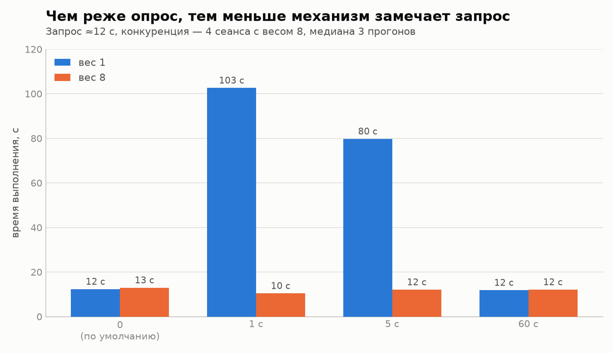
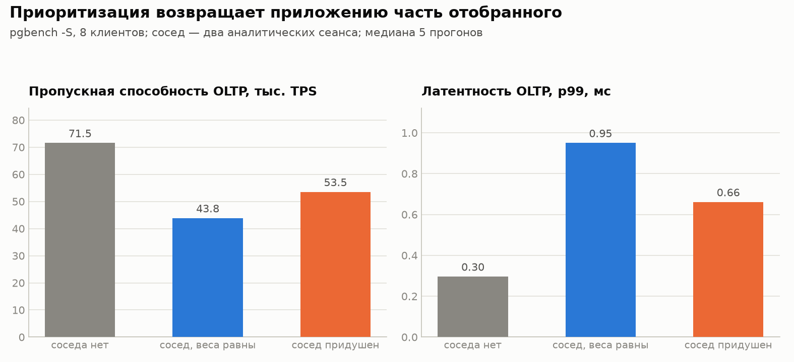

# Приоритизация ресурсов в Postgres Pro: как притормозить шумного соседа, не убивая его запрос

Приоритизацию нагрузки принято делать снаружи базы — cgroups, `nice`, отдельная реплика под аналитику. Postgres Pro Enterprise предлагает делать это внутри: раздавать сеансам веса по CPU и вводу-выводу и притормаживать тех, кто мешает остальным. Ниже — где проходит граница между cgroups и `pgpro_rp`, что расширение реально умеет по замерам на стенде, где оно молчит вместо работы, и четыре конфигурации, которые можно повторить у себя.

## Ситуация

Сервер с OLTP-нагрузкой. Приложение живёт в бюджете отклика, всё предсказуемо ровно до момента, когда в базу приходит кто-то ещё: аналитик с запросом на полчаса, ночная выгрузка, поехавшая по расписанию днём, BI-коннектор, решивший обновить витрину. Время ответа приложения уезжает вверх, и владелец системы задаёт единственный вопрос, на который у DBA нет ответа: когда отпустит?

Проблема даже не в самой просадке, а в этой неопределённости. Долгий запрос — чёрный ящик: он может доехать через минуту, а может через сорок. Пока он работает, приложение и аналитика делят одни и те же ядра, один и тот же диск, и планировщик операционной системы честно раздаёт всем поровну — а «поровну» здесь как раз неправильный ответ, потому что у этих двух нагрузок совершенно разная цена задержки.

Инструментов у DBA в этот момент ровно два, и оба плохие. Первый — терпеть: смотреть в мониторинг и надеяться, что скоро закончится. Второй — `pg_terminate_backend()`: latency вернётся мгновенно, но получасовая работа потеряна целиком, аналитик придёт ругаться и запустит запрос заново, скорее всего в самое неподходящее время. Между «ничего не делать» и «убить» нет ничего, хотя нужное действие очевидно: не убивать, а притормозить. Пусть отчёт едет вдвое дольше, но не мешает остальным.

Ровно это и предлагает [`pgpro_rp`](https://postgrespro.ru/docs/enterprise/18/pgpro-rp) — расширение Postgres Pro Enterprise для приоритизации ресурсов. Прежде чем разбираться с ним, стоит честно посмотреть, чем ту же задачу решают снаружи базы.

## Чем это лечат снаружи базы

**cgroups v2** — самый серьёзный инструмент в этом списке и, вероятно, самый недооценённый. Ядро умеет раздавать процессам доли процессора (`cpu.weight`), пропускную способность диска (`io.weight`, `io.max`) и жёстко ограничивать память (`memory.max`) — и делает это надёжнее любого механизма внутри СУБД, потому что стоит уровнем ниже и его нельзя обойти изнутри.

Проблема одна, и она структурная: cgroups ничего не знают про роли, сеансы и запросы. Они видят процессы. А клиентские бэкенды PostgreSQL порождаются postmaster'ом и наследуют его cgroup — на стенде это выглядит буквально так:

```
postmaster 11787: 0::/system.slice/postgrespro-ent-18.service
backend    13100: 0::/system.slice/postgrespro-ent-18.service
```

Оба в одной группе. Чтобы выделить аналитику меньше CPU, придётся снаружи ловить его PID и перекладывать в другую cgroup — писать демона, который смотрит в `pg_stat_activity`, сопоставляет сеансы с процессами и раскладывает их по группам. Это рабочая конструкция, я такие видел, но это уже собственная система, которую надо поддерживать. Плюс пропорциональное распределение диска в cgroup v2 включается не само собой: нужен либо настроенный контроллер iocost, либо планировщик BFQ со своим отдельным параметром, и на дефолтной конфигурации современного NVMe взвешивание чтения не работает вовсе.[^cgroups] Это тема для отдельной статьи; здесь достаточно границы — cgroups сильнее по гарантиям и слабее по знанию контекста.

**`nice` и `ionice` по PID** — то же самое, но вручную и разово. Нашёл процесс, понизил приоритет. Работает ровно до реконнекта: новый сеанс получает новый PID и приоритет по умолчанию, а пулер соединений делает реконнекты постоянными. Как разовое тушение пожара — сойдёт, как политика — нет.

**Разнесение нагрузки** — вынести аналитику на реплику, посадить её в отдельный пул pgbouncer с маленьким `pool_size`. Это лучшее решение из всех перечисленных, и если оно возможно, делать надо именно так. Но это ответ уровня инфраструктуры: нужна вторая машина, нужно смириться с лагом репликации, нужно, чтобы нагрузка была читающей. Когда всё это есть — вопрос закрыт. Когда сервер один, а разнести не выходит, задача возвращается туда же, откуда начинали.

Общее у всех троих — они не знают, кто именно подключился. Понятие «роль» существует только внутри СУБД, и именно там его удобнее всего использовать.

## Что предлагает pgpro_rp

Модель у расширения простая. Сеансу назначаются три веса — по процессору, по чтению и по записи:

- `session_cpu_weight` — использование процессора;
- `session_ioread_weight` — объём читаемых данных;
- `session_iowrite_weight` — объём записываемых данных.

Каждый принимает ровно четыре значения: 1, 2, 4 и 8. По умолчанию у всех сеансов везде 4. Проверка строгая с обеих сторон, промежуточные значения не проходят ни через `SET`, ни при создании плана:

```
test_low=> SET session_cpu_weight = 3;
ERROR:  Incorrect value of session_cpu_weight. Must be 1, 2, 4 or 8.

postgres=# SELECT pgpro_rp_create_plan('plan_3_3_3', 3, 3, 3);
ERROR:  unsupported value "3" for key "session_cpu_weight"
```

Набор из трёх весов — это **план приоритизации**, у него есть имя, и он назначается роли:

```sql
SELECT pgpro_rp_create_plan('plan_1_1_1', 1, 1, 1);
SELECT pgpro_rp_create_role_plan('analyst', 'plan_1_1_1');
```

Важное, что стоит понять сразу: абсолютные значения весов не значат ничего, значат только соотношения. Если выставить всем сеансам восьмёрку, не изменится ровно ничего — это то же самое, что всем выставить единицу. Механизм работает только тогда, когда сеансы с разными весами конкурируют за один ресурс.

План выбирается один раз, при входе, через событийный триггер, и порядок такой:

1. пользовательская функция выбора плана, если она зарегистрирована;
2. иначе — план, назначенный самому пользователю;
3. иначе — план с максимальной суммой приоритетов среди ролей, в которые пользователь входит (при наследовании через роли выигрывает самая щедрая);
4. если ничего не нашлось — дефолтные четвёрки.

Дальше в дело вступает фоновый процесс — в журнале сервера он представляется как `priority worker`. Раз в `usage_tracking_interval` секунд он смотрит, сколько ресурсов сеансы потребили относительно друг друга, и заставляет тех, у кого вес ниже, засыпать. Именно засыпать: приоритизация здесь — это принудительный простой, и он виден напрямую в отдельном представлении:

```sql
SELECT * FROM pgpro_rp_stat_sleep_view;

  pid  | time_slept
-------+------------
 12484 |       3960
```

Три девятьсот шестьдесят миллисекунд — столько этот бэкенд простоял не работая за время своей жизни, потому что ему назначили низкий приоритет. Никакого резервирования ресурсов, никаких квот: одним не дают больше, других притормаживают. Отсюда сразу следует, что суммарная пропускная способность сервера от включения приоритизации не растёт — она перераспределяется.

Область действия ограничена: приоритизация применяется к клиентским бэкендам и к фоновым процессам `pgpro_scheduler`. На остальные фоновые процессы — autovacuum, checkpointer, writer — веса не влияют. К этой формулировке из документации мы ещё вернёмся в разделе про ограничения, потому что у неё есть последствие, которое стоит увидеть на цифрах.

## Стенд, методика и точка отсчёта

Всё, что дальше, померено на одной машине:

- Postgres Pro Enterprise 18.4, Debian 12, `pgpro_rp` 1.4;
- 4 vCPU, 8 ГБ RAM, SSD;
- `shared_buffers` 1 ГБ.

Машина намеренно маленькая. Приоритизация — механизм про конкуренцию, а конкуренцию проще и честнее получить на четырёх ядрах, чем на тридцати двух: на большой машине пришлось бы поднимать нагрузку до неприличия, чтобы вообще увидеть эффект.

Данных три набора. `pgbench` масштаба 1000 — это 13 ГБ при 8 ГБ памяти, такая таблица не помещается ни в `shared_buffers`, ни в страничный кеш, и проход по ней упирается в диск: на ней меряются оси чтения. Таблица `t20` на 20 миллионов строк (2.5 ГБ) целиком лежит в страничном кеше, и проход по ней с вычислением `md5()` упирается в процессор: на ней меряется ось CPU. И отдельная база `oltp` масштаба 100 (1.5 ГБ, только чтение) — под OLTP-нагрузку в сценарии «шумный сосед»: это единственный способ получить воспроизводимые числа, на большом датасете с записью пропускная способность прыгала между одинаковыми прогонами от 50 до 344 транзакций в секунду.

Ролей четыре: `app` и `analyst` для сценария «шумный сосед», `test_low` и `test_high` — синтетические, с планами 1/1/1 и 8/8/8, для микро-замеров самого механизма.

Все скрипты лежат в [репозитории](https://github.com/lesovsky/articles/tree/master/2026-08-pgpro-rp) в порядке запуска, сырые данные — рядом. Каждая конфигурация прогонялась по три-пять раз, в тексте приводится медиана.

Две детали методики, важные при повторении. Первая: во всех микро-замерах параллелизм принудительно выключен (`max_parallel_workers_per_gather = 0`). Воркеры весам не подчиняются, и на дефолтных настройках тот же замер даёт не десятикратную разницу, а полуторакратную — отдельный раздел ниже это показывает. Вторая: сравниваемые веса меряются **одновременно**, а не по очереди. В первой версии скриптов они шли последовательно, придушенный запрос занимал две минуты, фоновая нагрузка успевала завершиться по `statement_timeout`, и «быстрый» замер снимался уже на свободной машине — получались красивые тринадцатикратные разрывы, которых не было.

И сразу точка отсчёта, без которой остальные числа не читаются. Один и тот же CPU-запрос, выполненный в одиночку на свободной машине:

| Роль | Вес CPU | Время |
|---|---|---|
| `test_low` | 1 | 8.83 с, 8.91 с |
| `test_high` | 8 | 8.77 с, 8.81 с |

Разницы нет. Это не баг и не сломанная настройка — это ровно то, чего и хотелось бы: пока за ресурс никто не борется, вес не значит ничего, и сеанс с минимальным приоритетом работает на полной скорости. Приоритизация включается только там, где есть конкуренция.

## Установка и две мины

Установка описана в документации и выглядит обычно: добавить расширение в `shared_preload_libraries`, перезапустить сервер, выполнить `CREATE EXTENSION pgpro_rp`. Предзагрузка нужна потому, что расширение держит кеш параметров в разделяемой памяти.

Одна мина попадается ещё до старта, и она не про `pgpro_rp`, а про `ALTER SYSTEM`: список с пробелами он закавычивает целиком, и сервер после перезапуска не поднимается с `could not access file "pgpro_scheduler, pgpro_stats, pgpro_rp"`. Пишите без пробелов после запятых или правьте конфигурационный файл руками.

Ещё одна вещь, которую стоит знать до того, как вы потратите на неё вечер: **планы приоритизации — объекты базы данных, а не кластера**. Таблицы, в которых расширение хранит планы и назначения, это обычные таблицы расширения, и живут они внутри той базы, где выполнен `CREATE EXTENSION`. В кластере с несколькими базами это выстреливает так: приложение работает в одной базе, аналитика в другой, планы заведены в одной из них — и приоритизация молчит.

Причём молчит она интереснее, чем можно ожидать. Сеансы базы, где планов нет, не просто получают веса по умолчанию — они выпадают из сравнения целиком, и механизм перестаёт притормаживать даже тех, у кого план есть. У меня на этом сценарий «шумный сосед» не работал до тех пор, пока я не завёл планы в обеих базах:

```
  pid  | usename | datname  |    plan    | time_slept
-------+---------+----------+------------+------------
 25009 | analyst | postgres | plan_1_1_1 |             <- плана нет у соседей по нагрузке,
 24995 | app     | oltp     |            |                поэтому не тормозится никто
```

После `CREATE EXTENSION` и создания планов непосредственно в базе приложения тот же сосед под той же нагрузкой замедлился с 9.2 до 32.0 секунды. Так что шаг «завести планы» нужно выполнить в каждой базе, где работают приоритизируемые сеансы.

## Параметр, без которого ничего не работает

План создан, роли назначены, `SHOW session_cpu_weight` в сеансах показывает единицу и восьмёрку — всё как задумано. Запускаем конкурентную нагрузку и меряем. Одинаковый CPU-запрос, четыре занятых ядра из четырёх:

| Роль | Вес | Три прогона |
|---|---|---|
| `test_low` | 1 | 11.8 / 12.3 / 12.5 с |
| `test_high` | 8 | 12.0 / 13.4 / 13.0 с |

Разницы нет. Планы назначены, веса видны, `pgpro_rp_stat_sleep_view` пуст, приоритизация не происходит. Причина — параметр `usage_tracking_interval`, у которого значение по умолчанию равно нулю. Ноль означает, что статистика потребления не собирается, а без неё нечего и сравнивать. В журнале сервера это написано прямым текстом, если знать, что искать:

```
LOG:  priority worker has started
LOG:  terminating priority worker because usage_tracking_interval is 0s
```

То есть после честного прохождения раздела «Установка» расширение стоит, но не делает ничего — и выглядит при этом полностью настроенным. Документация упоминает параметр единственный раз, в разделе [«Параметры конфигурации»](https://postgrespro.ru/docs/enterprise/18/pgpro-rp#PGPRO-RP-CONFIG), причём с формулировкой «При необходимости можно также управлять приоритетами вручную», которая читается как «дополнительная тонкая настройка», а не как обязательный шаг.

Выставляем интервал в секунду — и картина меняется радикально:

```sql
ALTER SYSTEM SET usage_tracking_interval = '1s';
SELECT pg_reload_conf();
```

| Роль | Вес | Три прогона |
|---|---|---|
| `test_low` | 1 | 102.6 / 101.9 / 121.0 с |
| `test_high` | 8 | 11.1 / 10.4 / 10.4 с |

Тот же самый запрос: с весом 8 — десять секунд, с весом 1 — сто две. Разница примерно в десять раз, и это существенно больше, чем можно ожидать от шкалы, где веса отличаются всего в восемь. Механизм не размазывает ресурс пропорционально весам, а довольно агрессивно отодвигает отстающих.

Оговорка, без которой это число легко понять неправильно: коэффициент зависит не только от весов, но и от состава нагрузки. Здесь один придушенный сеанс конкурирует с пятью приоритетными — отсюда и разрыв в десять раз. Когда сеансов с весом 1 и с весом 8 поровну (по четыре на четырёх ядрах), тот же механизм даёт разрыв всего 1.66×: 16.8–17.5 секунды против 9.9–10.3. Чем в большем меньшинстве оказывается низкоприоритетная роль, тем жёстче её отодвигают, и назвать одно число «во сколько раз медленнее» для шкалы весов нельзя.

Здесь же обнаруживается вторая, менее очевидная роль этого параметра. Документация советует не задавать маленькие значения, потому что частый сбор статистики стоит ресурсов, — совет разумный, и первое, что хочется сделать, это поставить что-нибудь спокойное вроде минуты. Вот что при этом происходит:

| `usage_tracking_interval` | Запрос ≈ 2.7 с | Запрос ≈ 12 с |
|---|---|---|
| 0 | эффекта нет | эффекта нет |
| **1 с** | **2.4×** | **≈ 10×** |
| 5 с | эффекта нет | ≈ 7× в двух прогонах из трёх, в третьем эффекта нет |
| 60 с | эффекта нет | эффекта нет |



Картина простая, если смотреть не на само значение интервала, а на отношение к нему длительности запроса. При опросе раз в секунду тормозится всё, что живёт хотя бы пару секунд, и чем дольше запрос, тем сильнее его отодвигают: 2.4 раза на трёхсекундном, десять — на двенадцатисекундном. При опросе раз в пять секунд двенадцатисекундный запрос — это всего два интервала, и эффект становится неустойчивым: в двух прогонах из трёх он есть, в третьем его нет вовсе. При опросе раз в минуту запрос короче интервала не замечают вообще.

Правило проверил отдельно, на запросе в 35 секунд: при интервале 1 и 5 секунд он честно замедляется в три-четыре раза, при интервале в минуту — не замедляется вовсе, потому что короче интервала. Величина при этом гуляет: в одном из прогонов с секундным опросом тот же запрос растянулся не втрое, а в тринадцать раз. Так что «во сколько раз» здесь — порядок, а не константа.

Практический вывод: `usage_tracking_interval` — это не ручка накладных расходов, а масштаб, в котором механизм видит нагрузку. Чтобы приоритизация работала предсказуемо, интервал должен быть в разы меньше длительности тех запросов, которые вы собираетесь притормаживать. Секунда — рабочее значение по умолчанию; минута означает, что под управление попадут только запросы, идущие много минут.

## Сценарий 1: шумный сосед

Базовая конфигурация, ради которой всё и затевалось: OLTP-нагрузка роли `app` (восемь клиентов `pgbench` на чтение, всё в памяти, упирается в процессор) и роль `analyst`, двумя сеансами крутящая в цикле аналитический запрос секунд на десять.

Три конфигурации: без соседа, сосед без приоритизации (у обеих ролей вес 4) и сосед придушен (`app` 8/8/8, `analyst` 1/1/1). Пять прогонов по минуте, в таблице медианы, разброс внутри конфигурации не больше 4%.

| | TPS | Средняя латентность | p95 | p99 | Проходов у соседа |
|---|---|---|---|---|---|
| Соседа нет | 71 550 | 0.112 мс | 0.207 мс | 0.296 мс | — |
| Сосед без приоритизации | 43 847 | 0.182 мс | 0.420 мс | 0.950 мс | 6 |
| Сосед придушен | 53 509 | 0.150 мс | 0.316 мс | 0.661 мс | 4 |



Читается это так. Приход соседа стоит приложению 39% пропускной способности, удваивает p95 и утраивает p99 — примерно то, из-за чего владелец системы и начинает задавать вопросы.

Приоритизация отыгрывает назад заметную часть, но не всё: пропускная способность поднимается с 43.8 до 53.5 тысяч транзакций (плюс 22%), p95 падает на четверть, p99 — на треть. В потерянных транзакциях это примерно треть от того, что забрал сосед. До состояния «соседа нет» далеко, и это ожидаемо: два аналитических сеанса на четырёх ядрах продолжают работать, их только притормаживают.

Сосед за это платит третью своей пропускной способности: четыре прохода за минуту вместо шести. Обратите внимание на пропорцию — приложение выиграло 22%, аналитика потеряла 33%. Это и есть суть механизма: суммарная производительность сервера не выросла, ресурс перетёк от одного к другому, и перетёк с потерями, потому что притормаживание — это простой, а не передача работы.

Здесь же выясняется важное условие, о котором стоит сказать прямо: **сосед и приложение должны конкурировать за один и тот же ресурс**. Первая версия этого замера у меня была устроена иначе — сосед грузил процессор, а OLTP-нагрузка упиралась в диск. Приоритизация в той конфигурации придушила соседа в семь раз, а приложению не дала ничего. Числа того прогона я не привожу: он снимался на нестабильной конфигурации, той самой, из-за которой методику пришлось переделывать, и точность там такая, что говорить можно только о направлении, а не о величине. Отобранный у соседа процессор приложению был не нужен, ему нужен был диск. Так что перед тем как раздавать веса, стоит посмотреть, за что именно идёт борьба, и раздавать их по той оси, где действительно тесно.

Хорошая новость в том, что ось чтения работает не хуже процессорной. Проверял отдельно: два плана, отличающиеся только весом `session_ioread_weight` (1 против 8, вес CPU у обоих 4), четыре сеанса читают таблицу в 13 ГБ со сброшенным страничным кешем, то есть действительно с диска.

| | Вес чтения 1 | Вес чтения 8 |
|---|---|---|
| Один проход в одиночку | 206 с | 215 с |
| Четыре сеанса одновременно | 395 / 401 / 396 с | 220 / 222 / 219 с |

Разрыв в 1.8 раза, воспроизводимость отличная: между прогонами меньше полутора процентов, а два сеанса одной роли внутри прогона финишируют с точностью до миллисекунды. И снова: в одиночку низкий вес не наказывается, разница появляется только там, где за диск действительно борются.

## Сценарий 2: день и ночь

Постоянные планы описывают статичную картину мира: эта роль всегда медленная, та всегда быстрая. Но нагрузка обычно ходит по расписанию — днём важно приложение, ночью важно, чтобы ETL успел до утра. Для этого в расширении есть группы назначений: несколько независимых наборов «роль → план», из которых активен ровно один.

```sql
SELECT pgpro_rp_create_group('day');
SELECT pgpro_rp_create_group('night');

-- днём приложение в приоритете, выгрузка придушена
SELECT pgpro_rp_create_group_role_plan('day',   'app',     'plan_8_8_8');
SELECT pgpro_rp_create_group_role_plan('day',   'analyst', 'plan_1_1_1');

-- ночью наоборот
SELECT pgpro_rp_create_group_role_plan('night', 'app',     'plan_1_1_1');
SELECT pgpro_rp_create_group_role_plan('night', 'analyst', 'plan_8_8_8');
```

Переключение — одна команда, которую логично повесить на планировщик:

```sql
CALL pgpro_rp_set_active_group('night');
```

Кеш параметров она сбрасывает сама — это единственное место в расширении, где `pgpro_rp_invalidate_cache()` звать не нужно.

Здесь две вещи, на которых легко споткнуться.

Первая — мелкая, но раздражающая: `pgpro_rp_set_active_group` это **процедура**, а не функция, и вызывается только через `CALL`. Справочник функций описывает её как `returns void`, то есть как функцию, и попытка сделать по справочнику заканчивается так:

```
postgres=# SELECT pgpro_rp_set_active_group('night');
ERROR:  pgpro_rp_set_active_group(unknown) is a procedure
LINE 1: select pgpro_rp_set_active_group('night')
```

Пример в самой документации при этом использует `CALL` — справочник функций и раздел с примерами описывают одно и то же по-разному. Мелочь, но пять минут отнимает.

Вторая важнее: **переключение группы не действует на уже открытые сеансы**. Проверял прямо: открыл сеанс роли `analyst` в дневном режиме (вес 1), в середине его жизни переключил активную группу на `night` и сбросил кеш — сеанс до самого конца показывал единицу, а восьмёрку получило только новое подключение.

И третье, на чём я обжёгся уже сам: активная группа — это глобальное состояние кластера, а не свойство отдельных ролей. Роль, у которой в новой группе плана нет, молча получает дефолтную четвёрку. У меня в группе `day` были расписаны только `app` и `analyst`, а синтетические роли для микро-замеров жили в группе по умолчанию — и после переключения на `day` два следующих эксперимента честно мерили полное отсутствие приоритизации, пока я не сообразил проверить `pgpro_rp_get_active_group()`. Никакой диагностики при этом нет: планы на месте, `pgpro_rp_roles_plans_view` их показывает, просто показывает для другой группы.

Логика понятна: план выбирается один раз, на входе. Но следствие для эксплуатации неприятное. Ночная выгрузка, которую вы придушили днём и которая всё ещё работает в 23:00, сама по себе не разожмётся — она доедет с дневным весом. Лечится это двумя способами: либо ETL переподключается после смены режима (для скриптовой выгрузки это обычно не проблема), либо ему повышают приоритет точечно, по PID, — а это уже следующий сценарий.

## Сценарий 3: не убивать, а притормозить

Ситуация из первого раздела: тяжёлый запрос уже работает, приложение страдает, а убивать жалко. В расширении для этого есть функция, которая применяет план к конкретному процессу по его PID:

```sql
SELECT pgpro_rp_backend_set_plan(28903, 'plan_1_1_1');
```

Выглядит как ровно то, чего не хватало. Проверяю: два сеанса роли с весом 8 запускают одинаковый долгий запрос, на восьмой секунде один из них понижаю до 1/1/1, второй остаётся контрольным.

| | Понижённый сеанс | Контрольный сеанс |
|---|---|---|
| Прогон 1 | 13.3 с | 12.4 с |
| Прогон 2 | 13.1 с | 12.3 с |

Разницы нет. Более того, понижённый сеанс ни разу не появляется в `pgpro_rp_stat_sleep_view` — его вообще не притормаживали. И это не потому, что приоритизация в тот момент не работала: в той же конфигурации сеанс, стартовавший с весом 1, идёт 102–124 секунды против 11 секунд у сеанса с весом 8.

Значит ли это, что функция бесполезна? Нет — она работает, просто не так, как ожидаешь. Повторяю опыт, но теперь сеанс выполняет два одинаковых запроса подряд, а понижаю я его во время первого:

| Сеанс | Первый запрос | Второй запрос |
|---|---|---|
| Понижен во время первого запроса | 13.8 / 12.8 с | **111.8 / 143.3 с** |
| Контрольный | 13.9 / 12.9 с | 10.7 / 10.8 с |

Вот теперь всё на месте. Новый план применяется начиная со следующего запроса сеанса, а текущий доезжает со старым весом.

Для долгоживущих соединений функция работает отлично, а таких соединений большинство: пул приложения, сеанс аналитика в `psql`, ETL-скрипт, который в цикле гоняет запросы. Увидели в `pg_stat_activity` роль, которая мешает, — понизили её сеансы по PID, и со следующего запроса они поедут медленнее, без реконнекта, без потери работы, без разговоров с владельцем сеанса. Это ровно тот инструмент, которого не хватало между «терпеть» и `pg_terminate_backend()`, и он же закрывает дыру из предыдущего сценария: сеанс, открытый до переключения группы, можно догнать вручную.

А вот погасить прямо сейчас конкретный запрос, который уже сорок минут жжёт процессор, не выйдет. Он доедет с тем весом, с которым начал. Если задача именно в этом, выбор по-прежнему между «дождаться» и `pg_terminate_backend()` — расширение здесь не помощник.

## Сценарий 4: своя логика выбора плана

Роль — не всегда то измерение, по которому хочется делить нагрузку: под одной ролью `app` ходит и веб-приложение, и ночной джоб, и чей-нибудь `psql` с ручным `UPDATE`. Для таких случаев есть точка расширения: функция, которая вызывается на входе и возвращает идентификатор плана.

```sql
CREATE FUNCTION rp_select() RETURNS bigint LANGUAGE plpgsql AS $$
DECLARE
  app  text := current_setting('application_name', true);
  hour int  := extract(hour from now());
BEGIN
  -- выгрузки и отчёты всегда уступают дорогу
  IF app IN ('etl', 'bi', 'pg_dump') THEN
    RETURN pgpro_rp_get_plan_id_by_name('plan_1_1_1');
  END IF;

  -- ночью, когда OLTP-нагрузки нет, придушивать некого
  IF hour < 6 OR hour >= 22 THEN
    RETURN pgpro_rp_get_plan_id_by_name('plan_8_8_8');
  END IF;

  RETURN pgpro_rp_get_plan_id_by_name('plan_4_4_4');
END $$;

SELECT pgpro_rp_set_plan_selection_function('rp_select');
SELECT pgpro_rp_invalidate_cache();
```

Функция без аргументов, возвращает `bigint` — идентификатор плана, который удобно получать через `pgpro_rp_get_plan_id_by_name()`. Она главнее всех остальных правил: если зарегистрирована, планы ролей не смотрятся вообще.

Внутри доступен весь SQL, а значит и всё, что база знает о подключении: `application_name`, имя пользователя, база, время суток, содержимое собственной таблицы-справочника. Последнее — самое интересное: можно завести таблицу «сервис → приоритет», отдать её на управление команде эксплуатации и менять приоритеты без единого вызова функций расширения. Тот же приём годится для мультиарендных схем, где приоритет зависит от тарифа арендатора, а не от роли в базе, — с оговоркой, что это именно приоритизация, а не изоляция: жёстких гарантий арендатору она не даёт (почему — в разделе про ограничения).

И здесь та же мина, что и везде в этом расширении, только злее. **Пока не вызван `pgpro_rp_invalidate_cache()`, функция не вызывается вообще.** Не «иногда», не «для старых сеансов» — совсем: применяется закешированный план роли, и по логам вы этого не увидите, потому что логов нет. Вот как это выглядит на одном и том же наборе подключений:

| Подключение | Сразу после регистрации функции | После `invalidate_cache()` |
|---|---|---|
| `application_name=etl` | 1 | 1 |
| `application_name=app` | 1 | 8 |
| `application_name=bi` | 1 | 1 |

Первый столбец — это план роли `test_low` (1/1/1), который отработал вместо функции. Второй — то, чего мы добивались. Разница в одном вызове, а выглядит как «функция не работает».

Зато после сброса функция отрабатывает на каждый вход и её решение не кешируется: подключения с разными `application_name` вперемежку стабильно получают разные веса.

## Сколько стоит наблюдение

Из предыдущего раздела понятно, что большой интервал делает механизм бесполезным. Осталось выяснить, сколько именно стоит секундный опрос, которым документация советует не злоупотреблять.

Меряю чистую OLTP-нагрузку без всякого соседа при разных значениях интервала. Восемь клиентов, `pgbench -S`, по три прогона, медианы:

| `usage_tracking_interval` | TPS |
|---|---|
| 0 (сбор выключен) | 73 962 |
| 1 с | 72 064 |
| 5 с | 73 752 |
| 30 с | 73 147 |
| 60 с | 73 329 |

Разброс между крайними значениями — 2.6%, то есть в пределах шума между прогонами. Разницы между «сбор выключен» и «опрос раз в секунду» на этой нагрузке просто нет.

Восемь сеансов — слабая проверка для механизма, который на каждом такте обходит все активные бэкенды, поэтому я повторил на двухстах соединениях: 45 834 транзакции в секунду при выключенном сборе против 45 615 при секундном опросе. Снова ничего — полпроцента разницы при разбросе между прогонами в пять раз больше.

Вывод получается приятный и слегка неожиданный: на масштабе в сотни соединений цены у наблюдения нет. Осторожность документации, видимо, рассчитана на другие порядки — тысячи сеансов или интервалы в десятки миллисекунд, до которых я не добирался. Но для типичной установки выбор значения `usage_tracking_interval` определяется не расходами, а тем, запросы какой длительности вы собираетесь притормаживать, — и с этой стороны секунда выглядит правильным значением по умолчанию.

## Чего инструмент не обещает

Здесь собрано то, что стоит знать до внедрения, а не после.

**Приоритизация обходится параллелизмом.** Документация говорит, что веса действуют на клиентские бэкенды и воркеров `pgpro_scheduler`, а на другие фоновые процессы не влияют. Параллельные воркеры обычных запросов — как раз «другие»: план они наследуют, а притормаживают только лидера:

| Параллелизм | Вес 1 | Вес 8 | Во сколько раз медленнее |
|---|---|---|---|
| `max_parallel_workers_per_gather = 0` | 120.1 с | 11.0 с | 11.0× |
| `max_parallel_workers_per_gather = 2` | 9.0 с | 6.7 с | 1.3× |

Придушенный запрос с двумя воркерами отработал в тринадцать раз быстрее, чем он же без параллелизма: приоритизация из одиннадцатикратной стала полуторакратной. И это ровно тот класс запросов, ради которого её включают — тяжёлая аналитика распараллеливается по умолчанию. Вывод: если душить всерьёз, `max_parallel_workers_per_gather` для роли надо прижимать отдельно, через `ALTER ROLE`.

**Роль может снять с себя ограничение.** Веса — это обычные GUC с `context = user`, поэтому любой пользователь делает так:

```
test_low=> SHOW session_cpu_weight;   -- 1, как назначено планом
test_low=> SET session_cpu_weight = 8;
SET
test_low=> SHOW session_cpu_weight;   -- 8
```

И это не косметика: новое значение реально применяется. Правами не закрывается — `REVOKE SET ON PARAMETER session_cpu_weight FROM PUBLIC` отрабатывает молча, записи в `pg_parameter_acl` не создаёт и обход не блокирует. Документация PostgreSQL про это честно предупреждает: право `SET` на параметр можно выдать на что угодно, но смысл оно имеет только там, где параметр и так требует прав суперпользователя. `ALTER ROLE ... SET` тоже не спасает: явный `SET` в сеансе перекрывает роль-уровневое значение.

Для типового сценария — сосед мешает не со зла и про эти параметры не знает — инструмент работает. Гарантии «роль не получит больше выделенного» он не даёт, и строить на нём изоляцию арендаторов нельзя.

**Памяти в модели нет.** Три оси — CPU, чтение, запись. `work_mem`, временные файлы, расход памяти на сортировках не управляются никак. Запрос с плохим планом всё так же способен забить диск временными файлами, и приоритизация тут не поможет — это то место, где cgroups с их `memory.max` остаются вне конкуренции.

**`RESET` теряет план, но пулер — нет.** Из трёх способов сбросить настройки сеанса план ломает ровно один: явный `RESET session_cpu_weight` возвращает общий дефолт 4, а `RESET ALL` и `DISCARD ALL` назначенный вес сохраняют. То есть пулер приоритизацию не ломает — тем более что в transaction pooling pgbouncer `server_reset_query` по умолчанию вообще не шлёт, он выполняется только в пулах session-режима. Зато точечный `RESET` — ещё один способ обойти план, если про него знать.

**Кеш инвалидируется руками.** Параметры пользователей кешируются в разделяемой памяти, и кеш не самообновляется: после изменения планов, назначений, членства в ролях или регистрации функции выбора плана нужно звать `pgpro_rp_invalidate_cache()`. Исключение одно — `pgpro_rp_set_active_group()` чистит кеш сама. Забыли — всё выглядит настроенным и ничего не меняется.

**Троттлинг не пишется в журнал.** Единственный источник данных — `pgpro_rp_stat_sleep_view`. В логе сервера есть только жизненный цикл фонового процесса (`priority worker has started`, `terminating priority worker because usage_tracking_interval is 0s`), а самих фактов притормаживания нет даже при `log_min_messages = debug1`. Постфактум разобрать, кого и насколько душили вчера ночью, не получится — нужно снимать представление в мониторинг заранее.

**И, само собой, это Postgres Pro Enterprise.** В ванильном PostgreSQL расширения нет; в управляемых сервисах его наличие зависит от того, предлагает ли провайдер именно Enterprise-сборку. Администрирование планов везде требует прав суперпользователя.

## Чеклист внедрения

Порядок, в котором это стоит делать. Почему именно так — в разделах выше.

1. **`pgpro_rp` в `shared_preload_libraries`, перезапуск сервера.** Список в `ALTER SYSTEM` пишите без пробелов после запятых.
2. **`CREATE EXTENSION pgpro_rp`** — в каждой базе, где работают приоритизируемые сеансы.
3. **Выставить `usage_tracking_interval`.** Единственный шаг, который нельзя пропустить: по умолчанию там ноль и приоритизация не работает. Секунда — разумное стартовое значение.
4. **Создать планы и назначить их ролям** — тоже в каждой базе. При наследовании через несколько ролей выигрывает план с максимальной суммой весов.
5. **`pgpro_rp_invalidate_cache()`** после любого изменения планов, назначений, членства в ролях или функции выбора плана. Исключение — `pgpro_rp_set_active_group()`, она чистит кеш сама.
6. **Мониторинг `pgpro_rp_stat_sleep_view` вместе с `pg_stat_activity`.** Растущий `time_slept` у роли, которая должна быть быстрой, означает, что придушили не того. Постфактум это не восстановить: в журнал факты притормаживания не попадают.
7. **Прижать параллелизм придушенным ролям** — `ALTER ROLE analyst SET max_parallel_workers_per_gather = 0` или небольшое значение.

## Итог

`pgpro_rp` закрывает нишу, которой снаружи базы закрыть нечем: он знает про роли и сеансы и настраивается на языке, на котором DBA и так думает про нагрузку — «этим быстрее, тем медленнее». cgroups сильнее по гарантиям и умеют память, но не отличают аналитика от приложения; разнесение по репликам решает задачу радикальнее, но требует железа.

Что важно понимать про механизм: это не квоты, а принудительный простой отстающих. Пропускная способность сервера не растёт, она перераспределяется — и только там, где есть конкуренция: на свободной машине вес не значит ничего.

Из четырёх разобранных конфигураций две — базовые и предсказуемые, а две дают то, чего у DBA раньше не было: понижение приоритета живому соединению без реконнекта и потери работы, и программируемая логика выбора плана на входе. С поправкой, которую стоит помнить: понижение по PID подействует со следующего запроса сеанса, а не на тот, что уже выполняется. Погасить прямо сейчас конкретный тяжёлый запрос расширение по-прежнему не умеет — здесь выбор остаётся между «дождаться» и `pg_terminate_backend()`.

Граблей у расширения хватает — они разобраны выше и все лечатся парой строк конфигурации. Общее у них одно: расширение молчит. Ни одна из этих ситуаций не сообщает о себе ни ошибкой, ни строкой в журнале, поэтому чеклист выше — не формальность, а единственный способ не потерять вечер.

Скрипты стенда, сырые данные и генератор графиков — в [репозитории](https://github.com/lesovsky/articles/tree/master/2026-08-pgpro-rp): `scripts/` в порядке запуска, `data/` с сырыми результатами, `RESULTS.md` с полной методикой и всеми прогонами, а не только медианами.

[^cgroups]: [Control Group v2](https://docs.kernel.org/admin-guide/cgroup-v2.html) в документации ядра Linux — описание `cpu.weight`, `io.weight` и контроллера iocost (`CONFIG_BLK_CGROUP_IOCOST`, файлы `io.cost.model` и `io.cost.qos`). Разбор модели стоимости — [«IO cost model based work-conserving proportional controller»](https://lwn.net/Articles/793460/) и [«The io.weight I/O-bandwidth controller»](https://lwn.net/Articles/792256/) на LWN.
